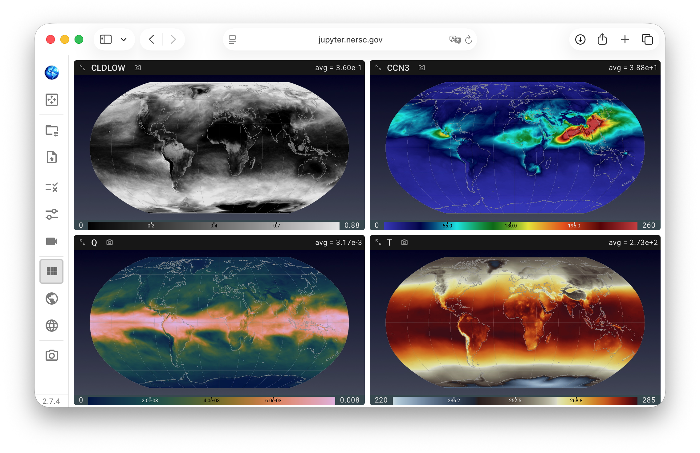

# QuickView

<!-- #region quickview-intro -->
**QuickView** is an open-source, interactive visualization
tool designed to help Earth system modelers take a quick look at
a collection of physical quantities in their simulation files.
The physical quantities are presented in the form of contour plots on global or regional maps.
Currently, QuickView supports cubed-sphere grids
consisting of either Gauss-Lobatto-Legendre (GLL) nodes (i.e., the `ne*np4` grids)
or finite-volume grid cells (`ne*pg2`, `ne*pg3`, etc.).

Under the hood, [ParaView](https://www.paraview.org/) and
[VTK](https://vtk.org/) supply the data-processing and graphics capabilities,
while [trame](https://www.kitware.com/trame/), a Python package,
is used to build a browser-based graphical User Interface (UI)
to provide intuitive and task-focused controls of the visualization
so that users do not need to operate ParaView or VTK themselves.
<!-- #endregion quickview-intro -->

<!-- #region quickview-key-features -->
## Key Features

- Intuitive, minimalist interface tailored for Earth system modeling.
- Multi-variable visualization.
- Persistent sessions—pick up where you left off.
- Currently supporting cubed-sphere grids in a variety of configurations.
  Examples can be found in the [visualization gallery](https://kitware.github.io/QuickView/gallery/).
<!-- #endregion quickview-key-features -->

## Installation

QuickView supports local installation through desktop bundles or conda, as well as
remote usage. See the [system requirements](https://kitware.github.io/QuickView/guides/system_requirements.html)
and [installation instructions](https://kitware.github.io/QuickView/guides/install_and_launch.html).

## Runtime dependencies

QuickView's runtime dependencies are listed under `requirements.run` in the
[conda-forge feedstock recipe](https://github.com/conda-forge/e3sm-quickview-feedstock/blob/main/recipe/recipe.yaml#L28).

## User's Guide

See [documentation page](https://kitware.github.io/QuickView/guides/quickview/getting_started.html).

<!-- #region quickview-project -->

## Project Background

QuickView is developed by [Kitware, Inc.](https://www.kitware.com/) in
collaboration with
[Pacific Northwest National Laboratory](https://www.pnnl.gov/), supported by the
U.S. Department of Energy's
[ASCR](https://www.energy.gov/science/ascr/advanced-scientific-computing-research)
and
[BER](https://www.energy.gov/science/ber/biological-and-environmental-research)
programs via [SciDAC](https://www.scidac.gov/).
The development of QuickView used resources of the National Energy Research Scientific Computing Center
([NERSC](https://www.nersc.gov/)), a U.S. Department of Energy User Facility.

### Contributors

- **Lead Developer**: Abhishek Yenpure (now at NVIDIA) for version 1; [Sebastien Jourdain](https://www.kitware.com/sebastien-jourdain/) ([Kitware, Inc.](https://www.kitware.com/)) from version 2 onwards.
- **Key Contributors**: Berk Geveci, Patrick O'Leary, Dan Lipsa, Will Dunklin (Kitware, Inc.); Hui Wan, Kai Zhang (PNNL)

<!-- #endregion quickview-project -->

## License

Apache Software License - see [LICENSE](LICENSE) file for details.

## Commit message convention

Semantic release rely on
[conventional commits](https://www.conventionalcommits.org/) to generate new
releases and changelog.
