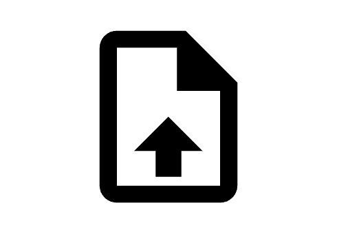
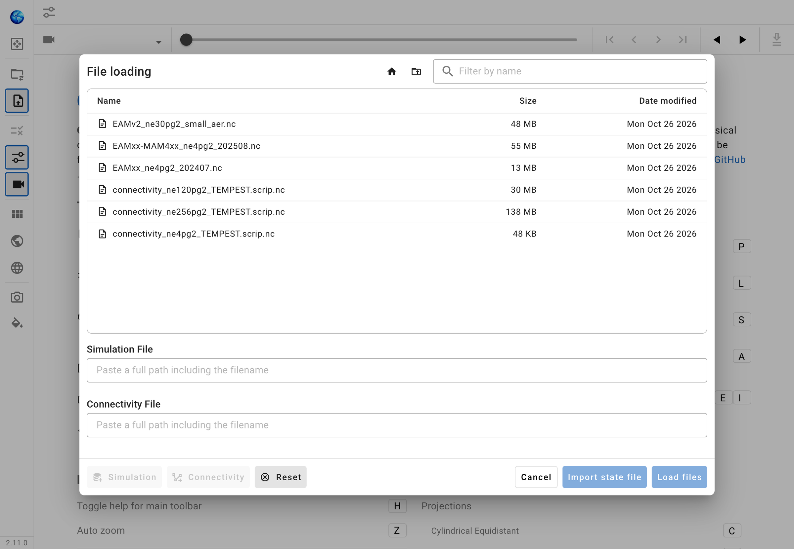
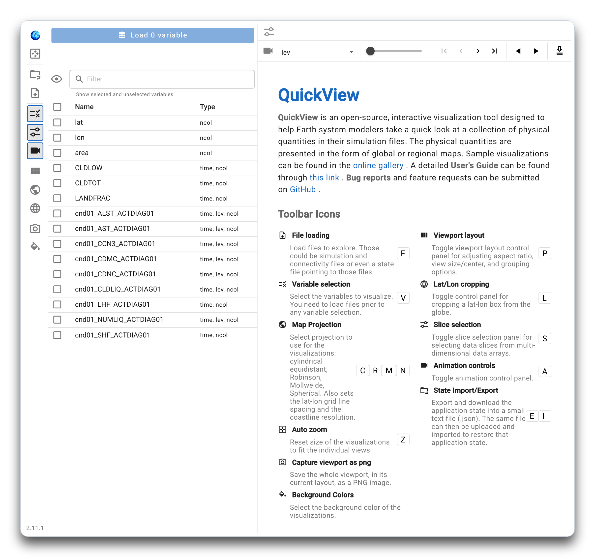
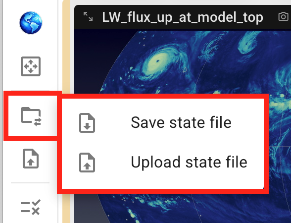

# Selecting Files for Analysis

QuickView can be used in two modes:
- a [**new-vis mode**](#new-analysis) for starting a new visualization or
- a [**resume mode**](#state-files) for continuing an earlier analysis saved in a state file.
Both are explained below.

## New-vis mode: starting a new analysis {#new-analysis}

{ width="5%", align=right }

When QuickView is launched using a shell command or the desktop bundle,
or when the user clicks the "File loading" icon on the toolbar,
a dialogue window like the screenshot below is brought up.
The user is expected to select a connectivity file and a simulation data file
using the file browser or the text boxes in this window.

{ width="100%", align=center }

### Selecting files using the file browser

Click the **Name**, **Size**, or **Date modified** column heading to sort the entries
by that column. Repeated clicks cycle through ascending order, descending order,
and the original order (directories first, then file groups, then individual files,
with each group sorted by name).

To narrow down a long listing, type part of a name in the **Filter by name** box
next to the navigation buttons at the top of the window.
The filter is cleared when moving to another directory.

The user can single-click a file name and then click the **Simulation** or **Connectivity**
button in the bottom-left corner to clarify file type.
The **Reset** button next to them clears both selected files.

Alternatively, if a filename contains "connectivity_" (case-insensitive), then
the user can **double-click** the file to have it automatically
recognized as a connectivity file.
Double-clicking a filename not containing "connectivity_" makes
it recognized as a simulation file.

### Selecting files by direct text input

If the needed files are many directories away from the directory shown in the file browser,
the user can avoid tedious navigation by pasting full paths, including filenames,
into the **Simulation File** and **Connectivity File** text boxes below the browser.

### Loading the selected files

After both connectivity and simulation files are selected,
the originally pale-blue `Load files` button in the bottom-right corner
changes to bright blue. A single click starts file loading.
The `Cancel` button closes the window without loading anything.

If the files are loaded correctly, the UI changes into a layout like
the example below, with the [Variable Selection control panel](./variable_selection)
on the **left** showing a **list of parsed variables**
and the viewport on the **right** showing a **brief introduction to QuickView**.
The user can now start to search for and load variables to inspect.

{ width="100%", align=center }

::: tip Tip: File system navigation
{ width="12%", align=right }
For QuickView installed through conda,
the *start directory* is the directory in which the app is launched via a shell command or script.
After launch, the File Loading dialogue window
shows the contents in that directory, and the user can double click
the listed subdirectories to go in–or use the folder icon with an upward arrow
to go to the parent directory. A click on the house icon brings the file browser
back to the start directory.
Because of this concept of the start directory, we recommend that
users launch QuickView in a directory close to their data
so that fewer clicks are needed in the file search.
:::

## Resume mode: picking up where you left off {#state-files}

{ width="28%", align=right }

The current state of the analysis session can be saved—and reloaded later to resume
the analysis—using the `State Import/Export` button in the vertical toolbar
or using the shortcut `I` for import and `E` for export.
The button opens a small menu with two entries:

- **Save state file** (shortcut `E`) opens the **Save QuickView State file** dialog.
  Enter a **Filename** (the default is `quickview-state.json`) and, optionally, a
  **Comments** text that is stored in the file as a reminder of what the state captures.
  Click **Save** (or press `Enter`) to save the file. Depending on the browser,
  the file is either downloaded directly or a save dialog lets you choose where to put it.
  This entry is available once variables have been loaded.
- **Upload state file** (shortcut `I`; called **Load state file** in the desktop app)
  opens a file picker to select a state file and restore it.

Note that regardless of whether QuickView is executed on a local computer
or on a remote system (e.g., at NERSC), these two entries save state files to and upload them from
the local computer, i.e., the computer running the web browser.

A state file that is already stored on the system where QuickView runs
(e.g., at NERSC) can be loaded without copying it to the local computer:
open the [File loading](#new-analysis) window, single-click the `.json` file,
then click the **Import state file** button at the bottom of the window.
The button is only enabled when the selected file is a valid QuickView state file.
A state file can also be loaded at startup with the
[`--state` command-line option](/guides/install_and_launch#cli).

::: info Info: What's in a State File?
A state file is a JSON file that contains the paths and names of
the connectivity and data files being used as well as the settings
the user has chosen for the visualization; the *contents* of the
connectivity and simulation files are *not* included.

The saved settings cover:

- the selected variables and, for each view, its position and size in the viewport;
- the viewport layout (aspect ratio, grouping, column arrangement), the open control panels, and the camera;
- the slice selection, the animation dimension and its current step;
- the map projection, the lat/lon cropping, the map center, the lat-lon grid line spacing,
  the coastline resolution (including "None"), and the background color;
- the full colormap configuration of each view: preset, inversion, color-blind filter,
  scale and discrete bands, fixed or automatic range, number of ticks, NaN and out-of-range colors,
  and diverging mode with its parameters.

Interaction modes are not saved: loading a state file turns cursor probing off.
State files saved by older versions of QuickView can still be loaded. If such a file has no
grid line spacing, map center, or coastline resolution, those settings are reset to their defaults
(30°, 0°/0°, and Low).

If a state file is shared among multiple users or used across different
file systems, or if a user wants to apply the same visualization settings
to a different simulation data file, then the file names and paths
at the beginning of the state file need to be edited before the state
file is loaded in the app.
:::
