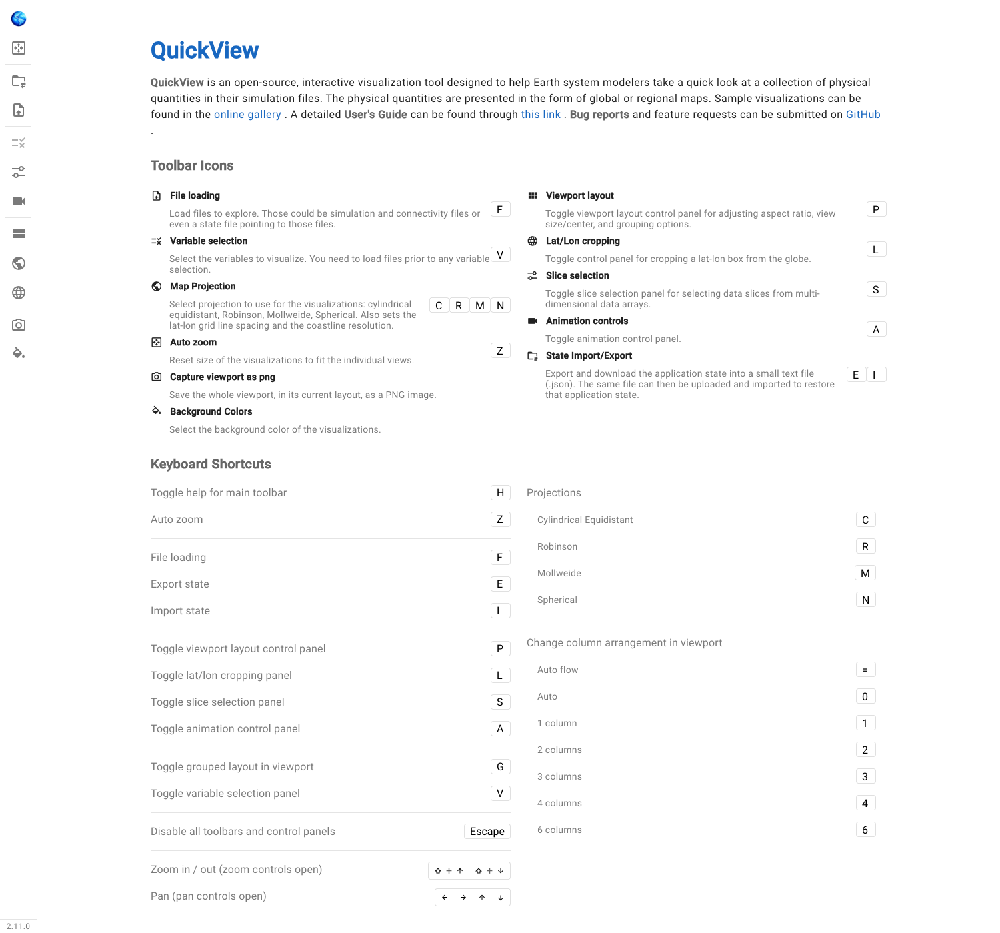

# Keyboard Shortcuts in QuickView

Below is a list of keyboard shortcuts in QuickView.
Most of them are single-key shortcuts, and hence will not
conflict with the multi-key combinations used by
the operating system or other applications.
Note that these shortcuts will only take effect
when the browser window (or tab) showing the QuickView UI
is the active window (or tab).
The same list is shown in the viewport while no variable is selected.

## General

| Key | Action |
| --- | ------ |
| `H` | Expand or collapse the main toolbar |
| `Z` | Auto zoom: fit each plot to its view |
| `F` | Open the [file loading](./file_selection) window |
| `E` | [Save (export) the state](./file_selection#state-files) to a file |
| `I` | [Load (import) a state file](./file_selection#state-files) |
| `Esc` | Close all control panels and collapse the toolbar |

## Control panels

| Key | Action |
| --- | ------ |
| `V` | Show or hide the [variable selection](./variable_selection) panel |
| `S` | Show or hide the [slice selection](./slice_selection) panel |
| `A` | Show or hide the animation control panel |
| `P` | Show or hide the [viewport layout](./viewport_layout) panel |
| `L` | Show or hide the [lat/lon cropping](./map_related#geographical-region) panel |

## Map projections

| Key | Projection |
| --- | ---------- |
| `C` | Cylindrical Equidistant |
| `R` | Robinson |
| `M` | Mollweide |
| `N` | Spherical |

## Viewport layout

| Key | Action |
| --- | ------ |
| `G` | Toggle between grouped and ungrouped views |
| `=` | Auto flow column arrangement |
| `0` | Auto column arrangement |
| `1`, `2`, `3`, `4`, `6` | Arrange the views in 1, 2, 3, 4, or 6 columns |

The column shortcuts also work with the `Alt` key held down (e.g., `Alt` + `2`).

## Zoom and pan

These shortcuts only work while the corresponding controls are open
in the [viewport layout](./viewport_layout#plot-size-relative-to-view-frame) panel.

| Key | Action |
| --- | ------ |
| `Shift` + `↑` / `Shift` + `↓` | Zoom in / out |
| `←` `→` `↑` `↓` | Pan the plots inside their views |

## Summary displayed in the app {#help-page}

{ width="100%" }
