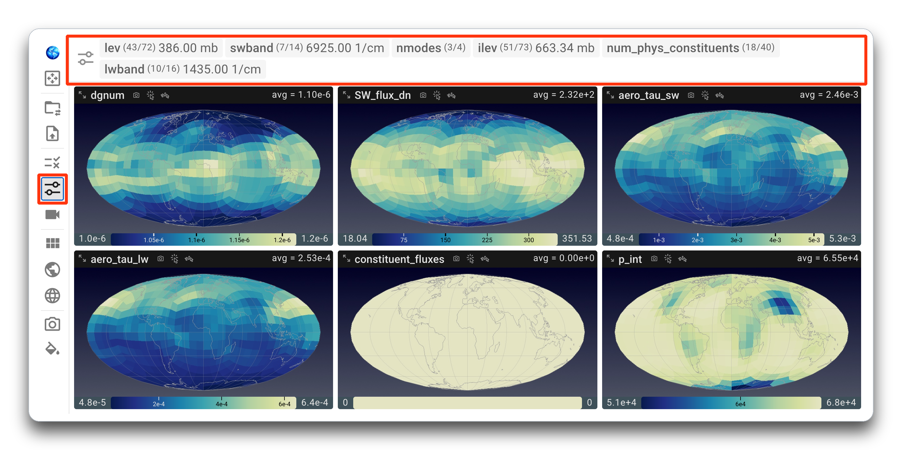
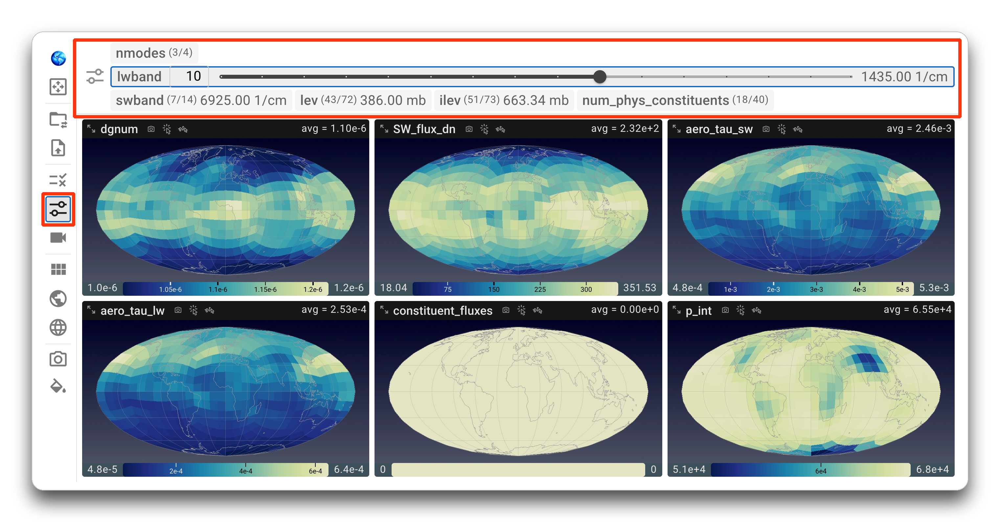
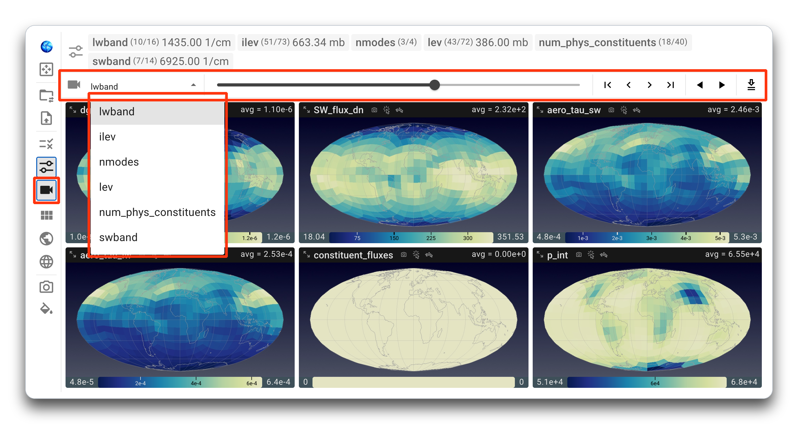

# Selecting data slices to inspect

QuickView displays simulation variables as contour plots on global or regional
maps, with one plot per variable at a time. To choose such a horizontal slice,
select one value or index along each non-horizontal dimension. For example, use
the [slice selection control panel](#slice-selection-control-panel) to choose the
second time step and the 500 hPa pressure level to show temperature at that time
and level. To compare slices along a single dimension, use the
[animation control panel](#animation-control-panel) to step through that
dimension on the same map.

## Slice selection panel {#slice-selection-control-panel}

Click <MdiIcon name="mdi-tune-variant" label="Slice selection" /> in the main
toolbar on the left, or press `S` to open the panel.

In the screenshot below, the red box across the top marks the slice
selection panel. The six gray tabs inside it are controls for non-horizontal
dimensions with more than one slice. Each tab shows the dimension name and the
current slice number out of the total, counting from 1. For example, `lwband`
shows `10/16` for the tenth of 16 slices. If the dimension has coordinate values
with units, the tab also shows the value and units for the current slice.

{ width="100%" align=center style="padding-bottom: 1.25rem" }

Click a dimension's tab to reveal a number field and a slider. To change the
slice, enter a slice number or drag the slider. In Chrome, hover over the
number field to reveal the up and down arrows, which change the slice one step
at a time. Click the dimension name again to collapse the tab.

{ width="100%" align=center style="padding-bottom: 1.25rem" }

## Animation control panel {#animation-control-panel}

Click <MdiIcon name="mdi-video" label="Animation controls" /> in the main
toolbar, or press `A` to open the panel.
Choose a dimension name from the drop-down menu at the left end of the panel.

{ width="100%" align=center style="padding-bottom: 1.25rem" }

- **Move through slices.** Drag the slider or use the four arrow buttons
  immediately to its right. From left to right, they are <MdiIcon name="mdi-page-first" label="First step" />, <MdiIcon name="mdi-chevron-left" label="Previous step" />, <MdiIcon name="mdi-chevron-right" label="Next step" />, and <MdiIcon name="mdi-page-last" label="Last step" />.
- **Play through slices.** Use <MdiIcon name="mdi-play" label="Play reverse" reverse /> or <MdiIcon name="mdi-play" label="Play forward" />.
  When the play icon changes to a square, click the <MdiIcon name="mdi-stop" label="stop button" /> to stop playback.
- **Export an animation.** Click <MdiIcon name="mdi-download-multiple-outline" label="Export animation (ZIP)" /> at the right end of the panel to open the export menu.
  See [Saving images](./saving_images#save-vis) for details.
