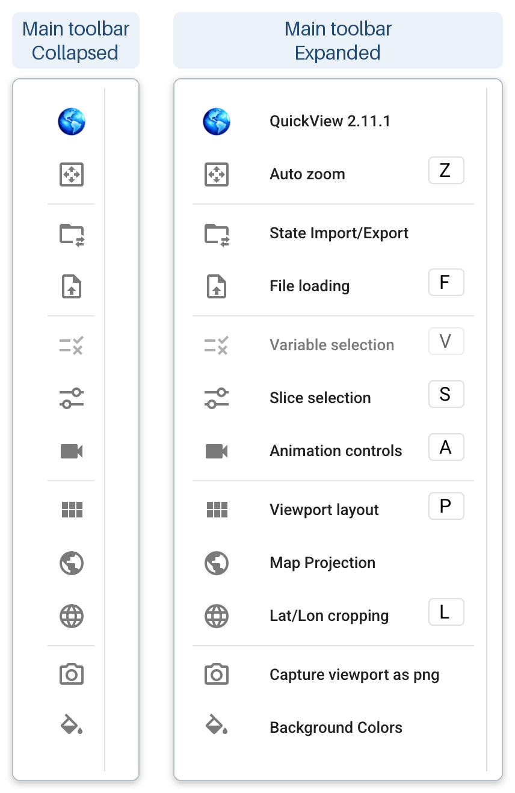

# QuickView's Graphical UI

{ width="100%" style="margin-top: 2.75rem" }

## UI components

QuickView's UI contains three main components.

- **Viewport.** The viewport displays contour plots on global or regional maps
  for the user-selected physical quantities (variables in the NetCDF files).
  The sequence of the displayed variables and the size of the contour plots
  can be adjusted using the [viewport layout](./viewport_layout.md) control panel.
  For each variable shown on a map, click the colorbar to open the
  [pop-up panel](./individual_views.md) and adjust the colormap, value range,
  and other settings.
  When no variables have been loaded from the simulation file,
  the viewport shows a [help page](./shortcuts#help-page).

{ width="40%" align=right style="margin: 0.5rem 0 1rem 1.25rem" }

- **Main toolbar.** The vertical toolbar on the left of the UI starts collapsed.
  Hover over an icon to see its short description.
  Click the QuickView icon or press `H` to expand the toolbar and see
  the short descriptions beside the icons.
  Click the QuickView icon or press `H` again to collapse the toolbar.
  The screenshot on the right shows both modes.

- **Control panels.** QuickView includes various control panels for
  changing the properties of contour plots shown in the viewport.
  The control panels can be collapsed (hidden)
  or expanded (shown) by clicking on their corresponding icons in the
  toolbar or by using [keyboard shortcuts](./shortcuts).
  See the [toolbar button table](#toolbar-buttons) for details.

## Buttons in the main toolbar {#toolbar-buttons}

The table below lists the toolbar buttons from top to bottom.
Buttons marked as "(toggle)" show or hide a control panel.

| Button | Shortcut | What it does |
| ------ | -------- | ------------ |
| QuickView icon | `H` | Expands or collapses the toolbar, i.e., shows or hides the button names. |
| **Auto zoom** | `Z` | Resets the zoom so that each plot fits its view. |
| **State Import/Export** | `E` / `I` | Menu to save the current state to a file or load a state file. See [Resume mode](./file_selection#state-files). |
| **File loading** (toggle) | `F` | Opens the window for selecting the simulation and connectivity files. See [Selecting Files](./file_selection). |
| **Variable selection** (toggle) | `V` | Panel for choosing the variables to visualize. See [Selecting Variables](./variable_selection). |
| **Slice selection** (toggle) | `S` | Panel for choosing a slice, such as a time step or vertical level, of a multidimensional variable. See [Selecting Data Slices](./slice_selection). |
| **Animation controls** (toggle) | `A` | Panel for stepping or playing through one dimension and for exporting animations. See [Selecting Data Slices](./slice_selection). |
| **Viewport layout** (toggle) | `P` | Panel for the view sizes, grouping, and aspect ratio. See [Customizing Viewport Layout](./viewport_layout). |
| **Map Projection** | `C` `R` `M` `N` | Menu to choose the projection, the lat-lon grid line spacing, and the coastline resolution. See [Map projection](./map_related#map-projections). |
| **Lat/Lon cropping** (toggle) | `L` | Panel for restricting the plots to a longitude/latitude box and for moving the map center. See [Geographical region](./map_related#geographical-region). |
| **Capture viewport as png** | | Saves the whole viewport as a PNG image. See [Saving Images](./saving_images). |
| **Background Colors** | | Menu to choose the background color of the plots. See [Plot background color](./map_related#plot-background-color). |

Pressing `Esc` closes all open control panels and collapses the toolbar.
The version number of QuickView is shown at the bottom of the toolbar.

::: info Note for developers
When QuickView is started with trame's `--hot-reload` option, an extra
**Refresh UI** button appears at the end of the toolbar. It rebuilds the UI
after a code change without restarting the application.
:::

<!-- ## Tooltips and visual cues -->
