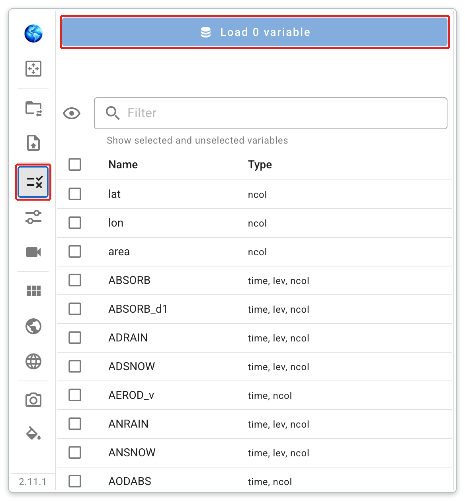
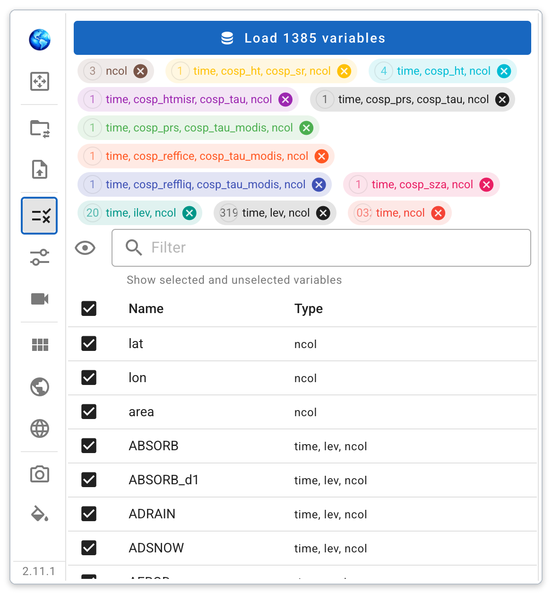
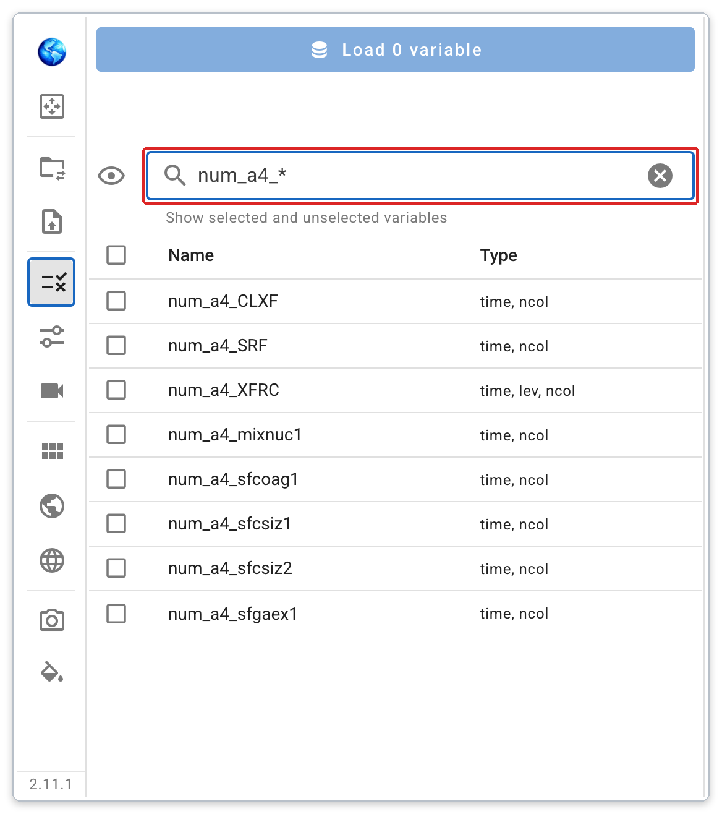
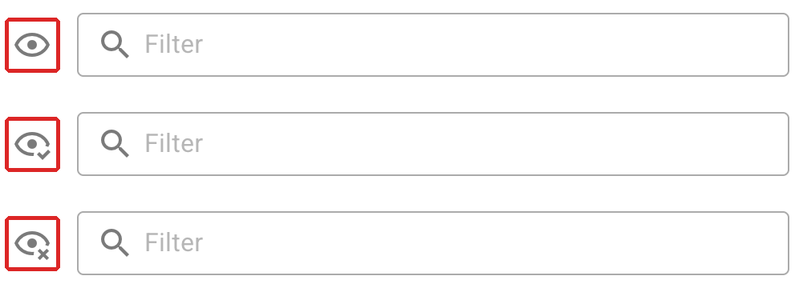

# Selecting Variables to Inspect

QuickView version 2 provides substantially improved variable search and selection
capabilities to better support simulation files with many variables and arrays of different shapes.
The examples on this page use a simulation file with more than 1,000 variables.

## Checkboxes

{ width="50%", align=right style="margin: 0rem 0 2rem 1.5rem"}

The screenshot shows the **Variable Selection** panel after QuickView opens a
simulation file. Click the toolbar button outlined in red to close or reopen the panel.

At this point, QuickView has finished scanning the simulation file for variables it can display.
With no variables selected, the wide button outlined in red is pale blue and
displays "Load 0 variable".

- Use the checkbox next to a variable name to select or deselect that variable.
- Use the header checkbox to the left of **Name** to select or deselect all
  variables in the current list.

When at least one variable is selected, the button turns solid blue, and its label
shows the current selection count. Click it to load the selected variables into
memory and display them in the viewport.

## Variable groups {#variable-groups}

{ width="50%", align=right style="margin:  0rem 0 2rem 1.5rem"}

QuickView groups variables by their shape, which is determined by their dimension
combination. In the screenshot, all 1,385 variables in the sample file are selected,
so QuickView displays every group as a colored tab. Each tab shows the group's
dimensions and how many of its variables are selected. The counts update as you
select or deselect variables.
Click the cross on a tab to deselect the entire group.

## Variable search

{ width="50%", align=right style="margin:  0rem 0 1rem 1.5rem"}

Use the **Filter** box above the variable list to search by name or dimensions.
The list updates as you type.

- **Fuzzy search** matches variable names or dimension names that contain the
  search term. It is case-insensitive.
- **Pattern search** matches variable names that start with `text` (`text*`) or
  end with `text` (`*text`). It is case-insensitive. In the screenshot,
  `num_a4_*` matches eight variables whose names start with `num_a4_`.
- **Strict search** uses double quotation marks to match a variable name exactly,
  such as `"T"` or `"U"`, or a full dimension list, such as `"time, lev, ncol"`.
  It is case-sensitive.

Separate search terms with spaces to require a match for every term (logical AND).
For example, `num lev` requires a match for both `num` and `lev`. Each term can
match either the variable name or its dimensions. The search `num_a4_* lev` shows
variables whose names start with `num_a4_` and that have `lev` in the name or dimension list.

{ width="50%", align=right style="margin: 1rem 0 1rem 2.5rem"}

To clear the filter, hover over the **Filter** box and click the cross at its right end.

## Variable lists

Click the eye icon to the left of the **Filter** box to cycle through three
display modes. The icon shows which mode is active.

{ width="50%", align=right style="margin: 0rem 0 1rem 1.5rem"}

- **Eye only** shows both selected and unselected variables.
- **Eye with a check mark** shows only selected variables.
- **Eye with a cross** shows only unselected variables.

When a filter is active, the display mode applies to the matching variables.

## Load variables for visualization

After selecting the variables you want to inspect, click the wide blue button
highlighted at the top of the Variable Selection panel in the
[Checkboxes screenshot](#checkboxes).
QuickView loads the selection and displays it in the viewport.
