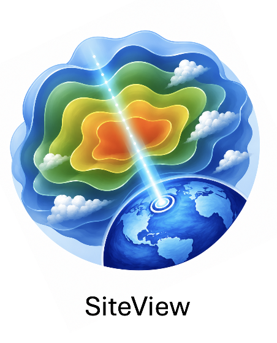

# What is SiteView?

{ width="15%", align=right }

SiteView is an open-source, interactive visualization
tool designed for the atmosphere component, EAM, of the Earth system model [E3SM](https://e3sm.org).
It uses 
[VTK](https://vtk.org/) as the analysis and visualization engine
and leverages
[trame](https://www.kitware.com/trame-architecture-and-capabilities/)
to provide an intuitive user interface.
The goal of SiteView is to support in-depth, process-level analysis of
an atmospheric column and its regional environment.

## Project Background

The lead developer of SiteView is
[Sebastien Jourdain](https://www.kitware.com/sebastien-jourdain/)
at [Kitware](https://www.kitware.com/).
Other key contributors include
[Berk Geveci](https://www.kitware.com/berk-geveci/)
at [Kitware](https://www.kitware.com/)
and Hui Wan, Kai Zhang at
[Pacific Northwest National Laboratory](https://www.pnnl.gov/atmospheric-climate-and-earth-sciences-division).

SiteView is a product of an interdisciplinary collaboration supported by
the U.S. Department of Energy Office of Science’s
[Advanced Scientific Computing Research (ASCR)](https://www.energy.gov/science/ascr/advanced-scientific-computing-research)
and
[Biological and Environmental Research (BER)](https://www.energy.gov/science/ber/biological-and-environmental-research)
via the
[Scientific Discovery through Advanced Computing (SciDAC](https://www.scidac.gov/))
program.

The development of SiteView used resources of the National Energy Research Scientific Computing Center
([NERSC](https://www.nersc.gov/)), a U.S. Department of Energy User Facility.

----

{ width="40%", align=center }
