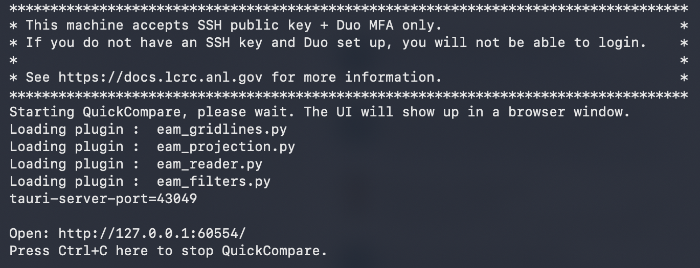

<script setup>
import { withBase } from 'vitepress'
</script>

# The QuickView Family on Chrysalis


[Chrysalis](https://e3sm.org/resources/supported-machines/chrysalis-anl/) is
a computer cluster dedicated to the E3SM project and its team members.
It is owned by the U.S. Department of Energy (DOE)
Office of Biological and Environmental Research (BER)
and maintained by Argonne National Laboratory (ANL).
This page explains how to launch QuickView and QuickCompare on Chrysalis
and provides tips for selecting your data files.

[[toc]]

## Public installation

QuickView and QuickCompare are installed in a `conda` environment located at
`/lcrc/group/e3sm/share/quickview/`.


:::warning Tip for SSH connection

If your typical login method does **not** include port forwarding,
skip the rest of this section and jump to [One-step launchers](#one-step-launchers).
:::

If your typical login method already supports port forwarding,
you can load the `conda` environment using

```sh
module load miniforge3/25.3.1
conda activate /lcrc/group/e3sm/share/quickview
```
Then launch QuickView or QuickCompare using
```sh
quickview
```

```sh
quickcompare
```

Take a sip of tea or coffee and wait for some more seconds until
your screen output looks like the following.
Enter your URL in a web browser to start using the tool.
```
Loading plugin :  /lcrc/group/e3sm/share/quickview/lib/python3.13/site-packages/e3sm_quickview/plugins/eam_gridlines.py
Loading plugin :  /lcrc/group/e3sm/share/quickview/lib/python3.13/site-packages/e3sm_quickview/plugins/eam_projection.py
Loading plugin :  /lcrc/group/e3sm/share/quickview/lib/python3.13/site-packages/e3sm_quickview/plugins/eam_reader.py
Loading plugin :  /lcrc/group/e3sm/share/quickview/lib/python3.13/site-packages/e3sm_quickview/plugins/eam_filters.py
tauri-server-port=42757

Use URL below to connect to the application:

  => http://localhost:42757/
```

## One-step launchers {#one-step-launchers}

Since tools in the QuickView family use browser-based user interfaces,
information needs to be passed from the server port on Chrysalis
to the local computer. The Python scripts linked below are one-step launchers
that each establish an SSH connection to Chrysalis with port forwarding and,
after QuickView or QuickCompare is started on Chrysalis,
open the UI in a browser on the local computer.

- Click to download: <a :href="withBase('/downloads/launchers/launch_quickview_on_chrysalis.py')"    download>launch_quickview_on_chrysalis.py</a>
- Click to download: <a :href="withBase('/downloads/launchers/launch_quickcompare_on_chrysalis.py')"    download>launch_quickcompare_on_chrysalis.py</a>

Execute the scripts on the local computer using one of the following commands,
replacing `USERNAME` by your username.
```sh
python3 launch_quickview_on_chrysalis.py USERNAME@chrysalis.lcrc.anl.gov
```

```sh
python3 launch_quickcompare_on_chrysalis.py USERNAME@chrysalis.lcrc.anl.gov
```
Enter your authentication information when prompted to do so.

After a successful login and some more seconds, the SSH session will print out text similar to the screenshot below.
If the tool's graphical user interface does not show up automatically in a web browser,
copy the URL printed after `Open:` into a web browser on your local computer.



## Connectivity files

Some [connectivity](/guides/connectivity) files are available in `/lcrc/group/e3sm/share/connectivity/`.
Additional files can be downloaded from [Zenodo](/guides/connectivity#connectivity-file-download).

## Tips for easier file selection

On HPC systems such as Chrysalis, simulation files and connectivity files may be stored in deeply nested directories with long paths. The QuickView family of tools treats the directory from which they are launched as their “home” directory. The one-step launcher scripts provided above launch the tools from your default login directory, so navigating to these files through the file dialog may require many mouse clicks. The following tips can help you reach your files more quickly; they can be used individually or in combination.

#### Tip 1. Set the launch directory in the launcher script

If you frequently work with files in the same directory, you can configure the launcher script to start the tool there.
In the `REMOTE_COMMAND` block, add a line like the following immediately after
`" && conda activate ..."`:
```py
" && cd /path/to/data/directory/ "
```
The tool will then use the specified directory as its "home" directory.

#### Tip 2. Create symbolic links to frequently used directories

On Chrysalis, in the tool’s launch directory, create symbolic links (soft links) to your simulation directories, e.g.,
```sh
ln -s /path/to/simulation1/ simulation1
ln -s /path/to/simulation2/ simulation2
```
These links provide shortcuts to your simulation directories
when the "home" button is clicked in the tool’s file loading dialog.

#### Tip 3. Keep the connectivity file with the simulation files

In each simulation directory, store a copy of the corresponding connectivity file
or create a symbolic link to it. This lets you select both the simulation files
and the connectivity file from the same directory.

#### Tip 4. Enter file paths directly in the UI

You can also copy and paste full file paths into the tool's file loading dialog.
Use full paths on Chrysalis.
For example, in [QuickView](/guides/quickview/file_selection),
enter the paths in the “Simulation File” and “Connectivity File” text boxes.

#### Tip 5. Use state files

A previously saved state file already contains the paths to your simulation and connectivity files.
Upload it from your local computer to resume the analysis without selecting those files again.
